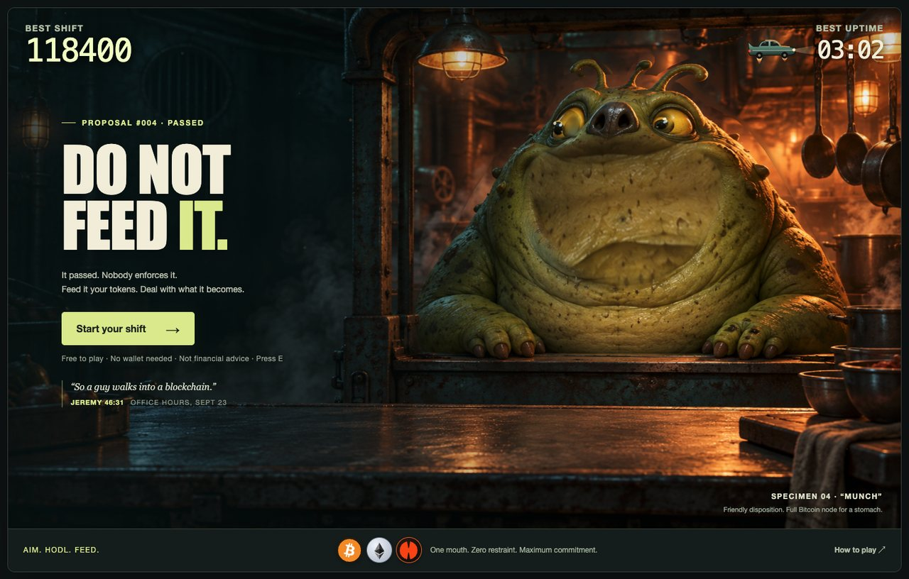
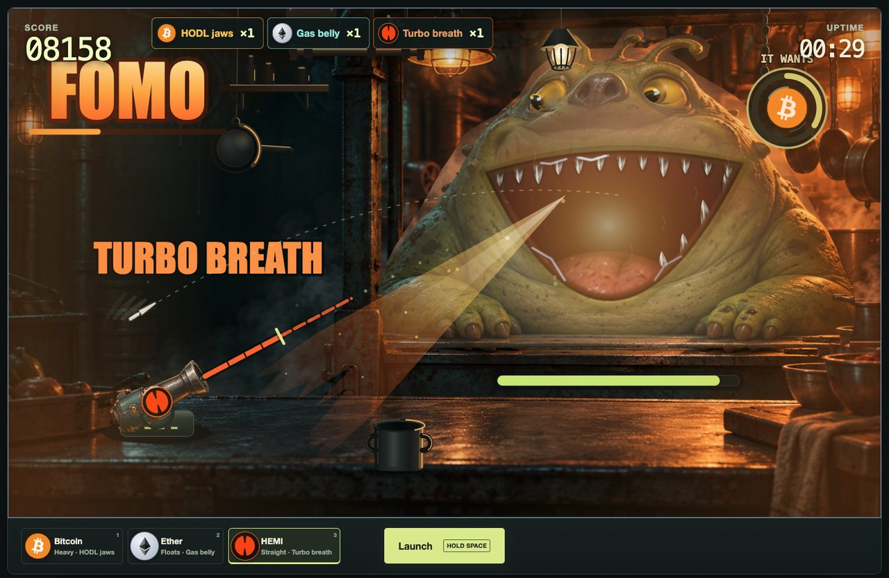

# Do Not Feed It

**Feed the creature. Deal with what it becomes.**

A browser arcade game for Hemi Arcade Contest 2: Turbo Edition. You work the
night shift in a kitchen where something hungry lives behind the hatch. You
launch coins into its mouth — Bitcoin, Ether and HEMI — and every coin changes
it. Feed it enough of one and it mutates for good. Feed it at all and it grows.
It always wins; the question is how long you last.

Optional filings record what everyone feeds it together on Hemi, and
tomorrow's creature is born with whatever the community gave it most.



**Play:** [do-not-feed-it.pages.dev](https://do-not-feed-it.pages.dev) · [Ledger](https://do-not-feed-it.pages.dev/ledger) · desktop browser · sound on

**Live status:** Hemi Mainnet filing, shared leaderboards and community
inheritance are enabled as of October 24, 2026. The contract is deployed and
verified on Sourcify. The [deployment record](docs/HEMI_DEPLOYMENT_HANDOFF.md)
describes the live checks and the remaining funded-wallet filing check.

**Free to play.** No wallet, account or token is needed to play, and nothing in
the game costs anything. Filing a finished shift on Hemi is optional and
requires one transaction plus its network gas fee. Finish a shift and choose
**File this shift** to record it with your wallet.

## How to play

| | |
| --- | --- |
| **← → / A D** or drag | Aim |
| **1 2 3** | Load Bitcoin, Ether or HEMI |
| **Space** (hold, release) | Charge and launch |
| **Esc** | Pause |
| **R** or **Space** | Ape back in after a shift |
| **E** | Press E. You'll know when. |

Each coin flies its own way. **Bitcoin** is heavy: lob it at full charge.
**Ether** floats in on a soft arc. **HEMI** flies dead straight: point it at
the mouth. The mouth is open unless it is chewing — a coin thrown into a
chewing mouth bounces off the teeth.

Every so often it **craves** one coin, and a ring around it says which and for
how long. The craved coin curves into the mouth on its own; feed it anything
else while it waits and it barely fills it — **NOT THAT.** Fill the order and
it calms down and stops growing for a moment; let the ring run out and it
throws a **MAXI TANTRUM**. One coin all shift is a strategy. It is not a good
one.

Bank a coin off the pan, the shelf, the chain, the pot or the lamp and the
serving multiplies (a **multi-hop**). Five catches in a row is **FOMO**: for a
few seconds everything counts triple. A block swings on a chain under the
ceiling, marked with one coin; hit it with that coin and everything inside
pours into the mouth.

**Enough of one coin changes it for good:**

- **Bitcoin → HODL jaws.** Its jaws pull metal in from across the room — forks
  off the walls, hardware wallets out of drawers. Catch a fork for a **HARD
  FORK** bonus; take one in your launcher and you're **FORKED**.
- **Ether → Gas belly.** It fills with gas and floats, and its belly bounces
  coins back up into its mouth.
- **HEMI → Turbo breath.** It breathes heat. A coin through the breath comes
  out **TURBO'D**, worth double; a turbo'd coin that hits the bench sets it on fire. It
  locks up every HEMI it eats, so technically the breath is veHEMI.

Every serving makes it bigger and hungrier. The shift ends when its belly runs
**OUT OF GAS**, when **THE KITCHEN GOT REKT**, or — for the very few — when it
reaches **SUPERFINALITY** at the twelve-minute cap. A casual player lasts about
three minutes.



## The creature talks back

The creature speaks in the words of Hemi's own livestreams. A catch might get
*HEY MAN, FIBER.* or *I DOUBLE DARE YOU.*; FOMO opens with *OH, DOCTOR.*; a
Bitcoin on the floor is *BITCOIN BEING BITCOIN.* The title, pause screen and
report quote the hosts as scripture — "Max 13:06 · Midweek with Max, Sept 15".
Every line, with its show, date and timestamp, is in
[docs/QUOTES.md](docs/QUOTES.md).

Every crypto word in the game is also literally true of what is on screen: a
HARD FORK is a fork, SLIPPAGE is drool, a TOKEN BURN is a fire, SCALING is the
creature getting bigger. A viewer who doesn't know the slang can still say
what happened.

## The community creature (onchain)

This integration is enabled on the live site. Public tickets, replay
attestations, stored traces and a simulated contract submission have passed
live checks. A real funded-wallet filing, mined game receipt and replay against
that onchain event remain an operator follow-up; no game transaction was sent
during activation validation.

1. **A ticket.** Before a shift the game asks the server for a run id, a seed
   and a snapshot of the community state. A shift is a **trace** — the
   player's launches, stamped by tick. The rules are deterministic, so the
   trace *is* the run.
2. **A replay.** When the shift ends, the verifier (a Cloudflare Worker)
   replays the trace with the authoritative rules and derives every number
   itself: score, uptime, coins fed by token, best combo, size, ending. It
   signs that result (EIP-712). A shift it cannot replay is never signed.
3. **A filing.** The player signs the same result and sends both signatures to
   the `FeedRegistry` contract on **Hemi Mainnet**. The contract checks both
   signatures, the rules version, the bounds and replay protection, records
   the result, keeps the player's best, and adds the coins to **the community
   pile** for the current epoch (one day). Only a wallet's first three filings
   in an epoch feed the pile, so one wallet can't pick tomorrow's creature on
   its own; later filings still count for its best and the board.
4. **The pile, read back.** The title says what the community fed it — *"The
   community fed it 61% BTC this epoch"* — and when the pile closes, with the
   top keepers under it. **The ledger** (`/ledger`) shows each recent epoch:
   what it was fed, the trait its creature came in with and the coin it passes
   on, plus a board for all time or any epoch.
5. **It inherits.** Last epoch's dominant coin gives the next creature that
   mutation at level 1 from the first tick: **LAST EPOCH: 61% BTC. TONIGHT IT
   HAS HODL JAWS.**

**Contract:** `FeedRegistry` on Hemi Mainnet (chain 43111):
[`0x909995303dBC651da54b1ab0FF75024E907039c2`](https://explorer.hemi.xyz/address/0x909995303dBC651da54b1ab0FF75024E907039c2).
Deployed October 24, 2026 in block `5582556`; [exact source verification on Sourcify](https://repo.sourcify.dev/43111/0x909995303dBC651da54b1ab0FF75024E907039c2).
Source: [contracts/FeedRegistry.sol](contracts/FeedRegistry.sol).

### Verifiable, not just signed

Every filing commits `keccak256(trace)` on chain, in the signed result and the
`ResultRecorded` event, and the site keeps every trace for good
(`GET /api/chain/trace?runId=…`, linked from the report as *Trace ↗*). Anyone
can replay a filed shift with the public rules and check it against the chain:

```sh
node --experimental-strip-types scripts/verify-filing.mjs \
  --site <the game's URL> --rpc https://rpc.hemi.network/rpc --tx <transaction hash>
```

It checks that the trace hashes to the `traceHash` on chain, that the snapshot
preimage hashes to the `snapshotHash`, that this repository's rules replay the
trace to exactly the attested numbers, and that the event holds the same
numbers, player and version.

The rules compute their own `sin`, `cos`, `atan2`, `exp` and `log` from exactly
specified arithmetic instead of the JavaScript engine's, so every browser
replays a shift bit for bit like the Worker;
`node --experimental-strip-types scripts/engine-check.mjs` builds a page that
proves it in whichever browser opens it. The engine is deterministic over a
compact trace, so the next step is a ZK proof of the replay in place of the
verifier's signature, with no change to what is committed.

### Trust model

The rules are the truth: a tampered trace fails closed. The verifier is one
server key; if it leaked, false results inside the contract's bounds could be
filed until the owner rotates the key (`setVerifier`) or pauses filing. The
player's signature is attribution, not proof of play: a bot that plays the real
rules files a real score, and one wallet is not one person. The contract holds
no funds, has no token, takes no approvals and cannot be upgraded. The board is
a cache of chain history that can always be rebuilt; when Hemi's RPC is down it
says so and goes stale rather than wrong.

Rules version 10 is frozen at the [activation commit](https://github.com/dimitryB/do-not-feed-it-submission/commit/c0439ec705ffb5f62ae0d0bb7a0ce4c1d63ba590).
The [public activation record](deployments/game-version-10.json) records the
rules hashes and live validation.
Every later change that affects a run's outcome must increase `GAME_VERSION`
and have the contract owner rotate the accepted version before filing resumes.

### Randomness and Bitcoin data

The seed is chosen by the server for each ticket and disclosed before play.
Players can request new tickets and search for a favourable seed or replay
strategy; the per-IP ticket limit reduces volume but does not prevent this.
Bitcoin miners do not choose the seed: the game does not read a Bitcoin header
as entropy. If a future mode
does, it will follow the caveats from Hemi's Engineering Office Hours (Oct 21):
Bitcoin data reaches hVM state with a delay, a miner can withhold a block, and
block timestamps can move forward by up to two hours, so players must commit
long before the block that decides the outcome.

The full design — the signed result, the contract, the indexer, the epoch and
pile rules — is in [docs/CHAIN.md](docs/CHAIN.md).

## Built with

TypeScript, React and canvas on [vinext](https://www.npmjs.com/package/vinext)
(Vite), hosted on Cloudflare Pages with its full server runtime. The onchain
backend uses Cloudflare Workers and D1. The production database, server verifier
and deployed registry configuration are active. The simulation is a pure,
fixed-tick, seeded module (`lib/game/`) with no DOM, clock or randomness of its
own; the renderer (`lib/render/`) only draws it. The contract is Solidity with
OpenZeppelin's ECDSA and EIP-712, tested with Hardhat; the client and Worker
use viem. Every note of music and every sound is synthesized in the browser.

## Run it locally

Node.js 22.13 or later:

```sh
npm ci
npm run dev
```

Open the local URL it prints. Practice needs no configuration; the chain
features switch themselves on only when the Worker has a contract address, a
verifier key and a database (see `.env.example` and `.dev.vars.example`).

| Command | What it does |
| --- | --- |
| `npm test` | The rules, replay, lore, chain, ledger and verifier tests |
| `npm run test:contract` | The `FeedRegistry` tests (downloads the Solidity compiler; `test:contract:js` uses the bundled solc-js instead) |
| `npm run check` | Types, lint, all tests and a production build |
| `npm run build:pages` | Package the full app and assets for Cloudflare Pages hosting |
| `node --experimental-strip-types scripts/chain-e2e.mjs` | The whole flow — ticket, play, replay, sign, file, inherit — through the real page on a local Hardhat chain |
| `node --experimental-strip-types scripts/loop-bots.mjs` | Plays hundreds of shifts with bot players, from a blind one to a good one, and reports the pacing |

<a id="deploy-the-practice-game"></a>

## Deploy the Pages game

The live game uses Cloudflare Pages Advanced Mode, including server rendering
and the API routes. Its configuration is in
[`cloudflare/pages/wrangler.jsonc`](cloudflare/pages/wrangler.jsonc). Production
has its D1 binding and CPU budget, with the verifier key stored only as
a Cloudflare secret. The verified registry address, deployment block and genesis
are configured in source and active in production. Local and preview
environments remain unbound practice. The October 24 activation deployment is
[`ee4546ca.do-not-feed-it.pages.dev`](https://ee4546ca.do-not-feed-it.pages.dev),
built from commit `c0439ec705ffb5f62ae0d0bb7a0ce4c1d63ba590`; the public game
continues to use [do-not-feed-it.pages.dev](https://do-not-feed-it.pages.dev).

From an authenticated Cloudflare account with access to this Pages project:

```sh
DNFI_SITE_URL=https://do-not-feed-it.pages.dev npm run build:pages
npx wrangler pages deploy --cwd cloudflare/pages --project-name do-not-feed-it --branch main
```

`build:pages` writes `dist/pages`: public assets, a reserved `_worker.js` bundle
and static-asset route exclusions. It also removes Vite's generated Workers
deployment redirect. Use the Pages command above to deploy this output; a plain
`wrangler deploy` targets Workers. The build origin also sets social-card URLs.

**Onchain setup:** The current Pages project has its deployment parameters in
[the handoff](docs/HEMI_DEPLOYMENT_HANDOFF.md); do not deploy a second registry.
For a separate installation, follow [the deployment guide](docs/CHAIN.md#11-deployment)
for a new contract, D1 migrations, Worker secrets and a production build.
`wrangler.example.jsonc` is a template: copy it to `wrangler.production.jsonc`
and fill in your own account, database and deployed contract settings. Build
with `DNFI_WRANGLER_CONFIG=wrangler.production.jsonc` and `DNFI_SITE_URL` set to
the public game URL. A plain `npm run build` uses a local placeholder database
and is for local review; it is not configured for a live chain deployment.

## Repository

The pre-publication findings, fixes, validation and remaining deployment work
are recorded in [docs/RELEASE_REVIEW.md](docs/RELEASE_REVIEW.md).

| Path | |
| --- | --- |
| `app/` | The page, the ledger page and the React shell |
| `lib/game/` | The rules: deterministic, seeded, replayable |
| `lib/render/` | The kitchen, the creature, the captions and the lore |
| `lib/engine/` | Render core, effects, post-processing, textures and audio |
| `lib/chain/` | The signed result, the wallet flow and the ledger view |
| `worker/` | The Cloudflare Worker: tickets, replay, attestation, indexer |
| `cloudflare/pages/` | The live site's Pages deployment configuration |
| `contracts/`, `test/` | `FeedRegistry` and its Hardhat tests |
| `db/`, `drizzle/` | The Worker's D1 schema and migrations |
| `tests/` | Rules, replay fixtures, lore, chain and verifier tests |
| `scripts/` | Dev, checks, the e2e harness, the bots, deploy and `verify-filing` |

## Credits

Made by Dimitry B ([dimitryB](https://github.com/dimitryB) on GitHub, dbur on the Hemi Discord), with AI assistance.
Some infrastructure is reused from the author's own
[Proof of Patience](https://github.com/dimitryB/proofOfPatience), the Contest 1
entry. The kitchen and launcher art is original and generated for this
project; the Bitcoin, Ethereum and HEMI marks belong to their owners and are
drawn unmodified. The creature's lines are quotations from Hemi's public
livestreams. Details in [THIRD_PARTY_NOTICES.md](THIRD_PARTY_NOTICES.md),
[docs/ART_PROVENANCE.md](docs/ART_PROVENANCE.md) and
[docs/QUOTES.md](docs/QUOTES.md).

This is a fan-made contest entry. Nothing in it implies that Hemi made or
approved it. Not financial advice.

MIT License, Copyright (c) 2026 Neva Technologies Inc — see [LICENSE](LICENSE).
